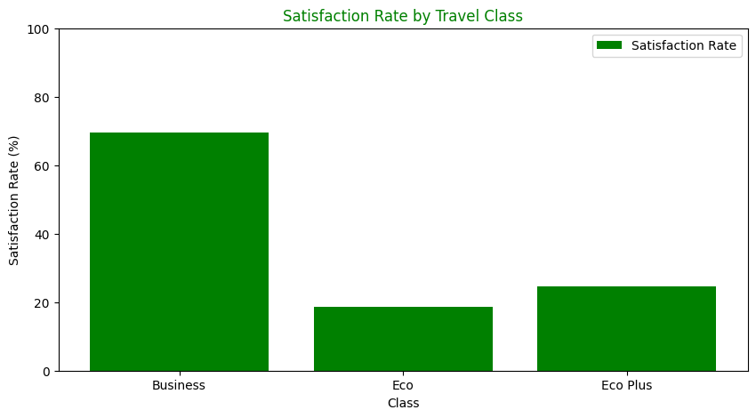
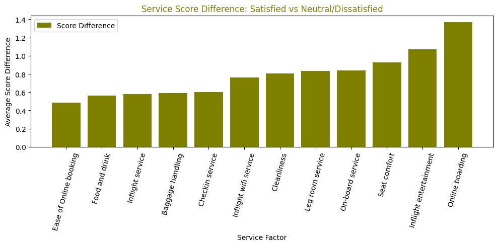
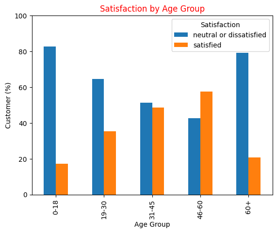
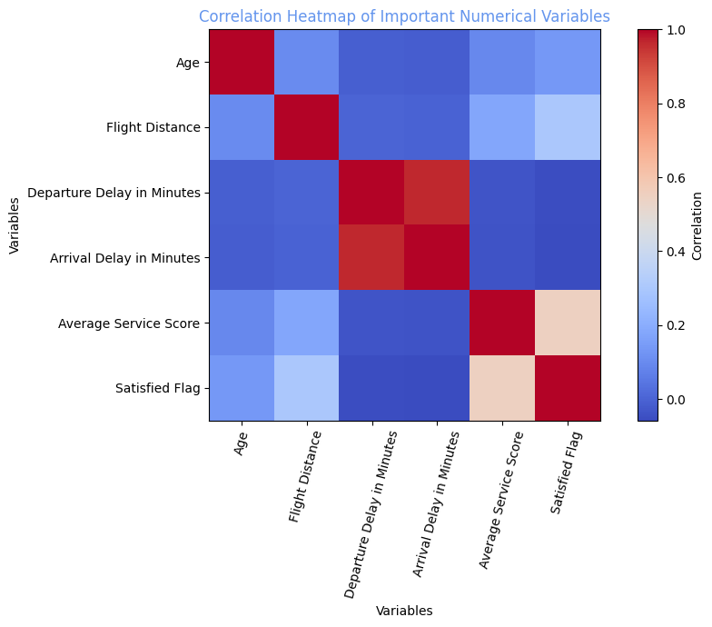

# ✈️ Airline Passenger Satisfaction Analysis

Exploratory data analysis of **103,594 airline passengers** to find out what drives customer satisfaction, and what management can do about it.

> Course project: *MIS24102E – Programming and Algorithms II*, Department of Management Information Systems, Fatih Sultan Mehmet Vakıf University


---

## 🎯 Goal

Only a minority of passengers say they are satisfied. This project looks at **who** is dissatisfied and **why**, using passenger profile, travel class, flight distance, delays and 14 in-flight service ratings. It ends with recommendations for airline management.

## 📊 Key Findings

| | Finding |
|---|---|
| 1 | Only **43.3%** of passengers are satisfied; 56.7% are neutral or dissatisfied. |
| 2 | **Business Class** satisfaction is **69.4%**, versus only **18.6%** in Economy and **24.6%** in Eco Plus. |
| 3 | The services that most separate satisfied from dissatisfied passengers are **Online Boarding** (+1.37 pts), **Inflight Entertainment** (+1.07) and **Seat Comfort** (+0.93). |
| 4 | The **46–60** age group is the most satisfied (57.4%); **0–18** (17.3%) and **60+** (20.7%) are the least. |
| 5 | **Long-distance** flights have far higher satisfaction (65.9%) than short and medium ones (~33%). They are also dominated by Business Class passengers. |
| 6 | Delays hurt satisfaction (47.3% with no delay vs. ~35.5% with medium/long delays), but service quality matters more. |

<p align="center">
  
  
</p>
<p align="center">
  
  
</p>

All charts are in the [`images/`](images) folder.

## 💡 Recommendations

1. **Improve the key service drivers:** online boarding, inflight entertainment and seat comfort.
2. **Fix the Economy Class experience.** It is the largest passenger group and has the lowest satisfaction.
3. **Protect Business Class quality.** It is the airline's strongest segment.
4. **Reduce operational delays.** They are a secondary but consistent source of dissatisfaction.

## 🛠️ Methodology

1. **Data cleaning:** dropped the index column, checked for duplicates, removed 310 rows with missing *Arrival Delay* (103,904 → 103,594 rows).
2. **Feature engineering:**
   - `Satisfied Flag` (0/1) with `np.where()`
   - `Age Group` with `pd.cut()`
   - `Delay Category` (No / Small / Medium / Long)
   - `Distance Category` (Short / Medium / Long)
   - `Average Service Score` across the 14 service ratings
3. **Analysis:** `groupby()`, `crosstab()`, a service-score gap comparison and a correlation matrix
4. **Visualization:** 8 Matplotlib charts

## 📁 Repository Structure

```
├── airline_satisfaction_analysis.ipynb   # Full analysis (code + outputs)
├── images/                               # Exported charts
├── reports/
│   ├── Airline_Passenger_Satisfaction_Report.pdf
│   └── Airline_Satisfaction_Presentation.pptx
├── requirements.txt
└── README.md
```

## ▶️ How to Run

1. Download `train.csv` from the Kaggle dataset **[Airline Passenger Satisfaction](https://www.kaggle.com/datasets/teejmahal20/airline-passenger-satisfaction)** and place it next to the notebook.
2. Install the dependencies and open the notebook:

```bash
pip install -r requirements.txt
jupyter notebook airline_satisfaction_analysis.ipynb
```

## 👤 Author

**Recep Efkan Aykıner**, Management Information Systems student, Fatih Sultan Mehmet Vakıf University
